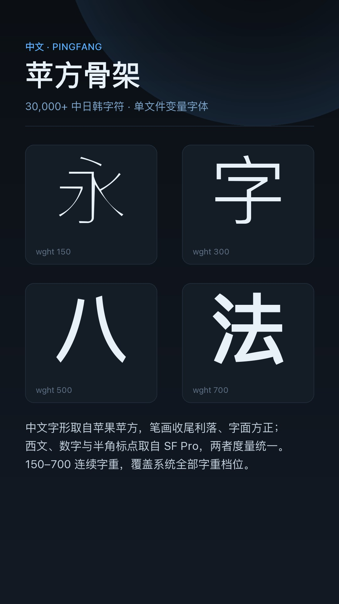
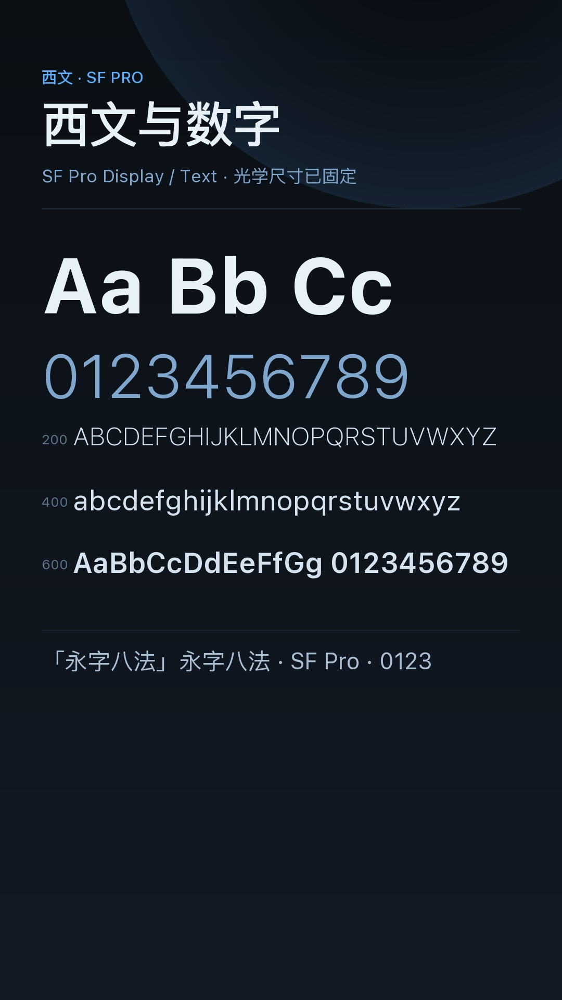
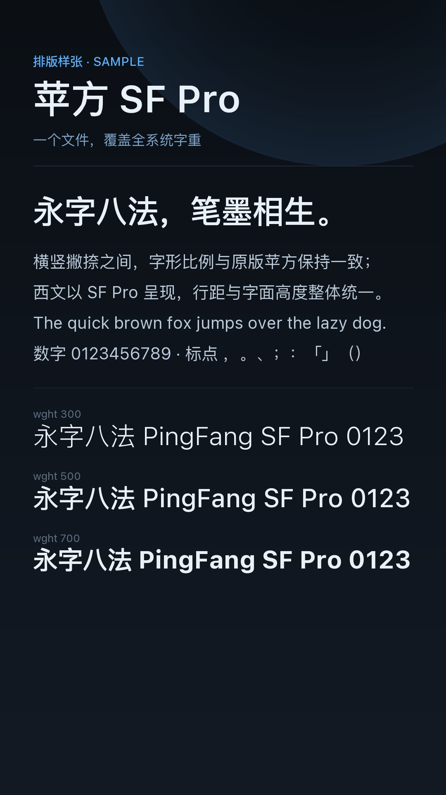
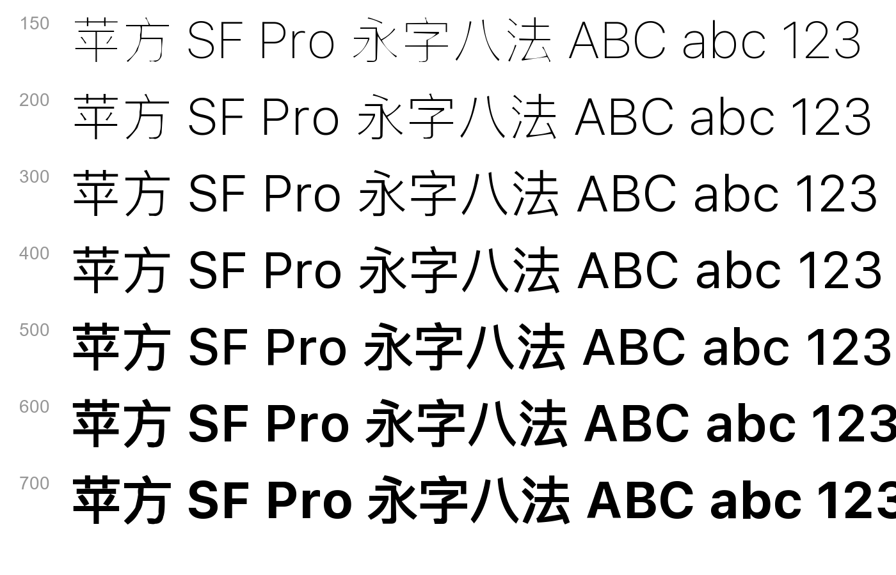

# 苹方 SF Pro · PingFang SF Pro

> 一个 MIUI / HyperOS 字体主题包（`.mtz`）：**中文字形取苹方（PingFang SC）**，**西文、数字与半角标点取 SF Pro**，
> 打包为**单文件可变字体**，`wght` 轴 150–700 连续可调，一个文件覆盖系统全部字重档位。


---

## 一、成品

| 项目 | 数值 |
| --- | --- |
| 主题包 | `dist/PingFang-SFPro_v1.0.mtz`（约 21 MiB，zip 压缩） |
| 字体文件 | `fonts/Roboto-Regular.ttf`（39,053,128 字节，变量字体） |
| 字形数 | 31,754 个 glyph / 30,666 个码位 |
| 字重轴 | `wght` 150 – 700（默认 400），12 个命名实例 |
| 垂直度量 | hhea 1060 / -340 / 0，OS/2 typo 880 / -220 / 0，win 1060 / 340 |
| 表 | fvar gvar HVAR STAT GDEF GSUB GPOS cmap glyf hmtx … （无 DSIG） |

命名实例：150 Ultralight、200 Thin、300 Light、400 Regular、500 Medium、600 Semibold、700 Bold，
以及 250 / 350 / 450 / 550 / 650 五个中间档（对齐主题包 `description.xml` 的 `fontWeight` 列表）。

### 预览

| 中文骨架 | 西文与数字 |
| --- | --- |
|  |  |

| 排版样张 | 字重校准图 |
| --- | --- |
|  |  |

---

## 二、设计说明

### 1. 为什么要做成「一个变量字体」

MIUI / HyperOS 的主题字体目录只认 `fonts/Roboto-Regular.ttf` 这一个文件，系统会按
`description.xml` 里的 `<fontWeight>` 列表去取不同字重。传统做法是塞多个静态 TTF
（体积翻倍、还容易漏档），本项目改为**一套 7 个「逐点完全兼容」的母版合并成一个变量字体**，
系统取 150–700 之间任意字重都能直接描出来。

### 2. 中西文分工

| 字符范围 | 来源 |
| --- | --- |
| CJK、假名、全角标点、注音等（约 29,180 码位） | PingFang SC |
| 拉丁 / 希腊 / 西里尔 / 数字 / 半角标点 / 符号箭头（约 1,485 码位） | SF Pro（Display 光学尺寸固定为 17） |

SF Pro 是 variable font（`opsz` 17–28，`wght` 1–1000，upem 2048），构建时按字重实例化、
缩放到 1000 upem、裁剪到上表范围；苹方为 6 个静态字重，取上表范围的补集。
两边码位互补、每个母版字形集合完全一致，所以合并后 7 个母版共享同一套 glyph 顺序（31,754 个）。

### 3. 中文字重是怎么来的（本项目的核心）

苹方官方只提供 6 个静态字重，且**各字重之间的轮廓点并不兼容**（把 6 个字重直接丢进
`fontTools.varLib` 会失败：形状签名匹配率只有 28%–48%）。因此本项目的做法是：

1. 以**苹方 Regular 的轮廓拓扑**为唯一骨架，7 个母版逐点一一对应；
2. 每个字重的目标「墨量」由真实苹方字重测量得到（对 25 个随机 CJK 采样，相对 Regular 的
   面积比：Ultralight 0.345、Thin 0.514、Light 0.777、Regular 1.000、Medium 1.279、Semibold 1.388）；
3. 逐 glyph 求解**法线方向轮廓外扩 / 内缩距离**（miter 法线 + 每点碰撞钳制，避免细笔画自交），
   使面积与目标一致；初值由面积-距离线性关系给出，随后用 Newton 迭代（最多 5 轮）收敛；
4. 轮廓绕向不一致的字（如「四」）会通过「沿法线跳 3 个单位后是否落在墨内」的经验探测自动纠正方向，
   否则会出现「外扩反而变细」的迭代发散；
5. 700 档由 500 / 600 的真实比例线性外推，避免 varLib 自行外推导致字面塌陷。

收敛后的残余面积误差：200 档 1.3%、300 档 1.2%、500 档 0.9%、600 档 1.1%、700 档 1.3%
（100 档因极细笔画受碰撞钳制影响，约 8%）。

**质量对照（25 个随机 CJK 的轮廓 IoU，合成母版 vs 苹果真身）**

| 字重 | 合成 vs 真身 | 基线：Regular vs 真身 |
| --- | --- | --- |
| 200 Thin | 0.534 | 0.514 |
| 300 Light | 0.828 | 0.775 |
| 500 Medium | 0.863 | 0.780 |
| 600 Semibold | 0.825 | 0.717 |

也就是说：合成字重比「直接把 Regular 当 Thin/Light/Medium 用」更接近苹果原版字形。
渲染出来的墨量覆盖随字重严格单调（150→700：2.13% / 2.90% / 3.91% / 4.74% / 5.78% / 6.51% / 7.16%）。

### 4. 必须说明的局限

* **只有 400 档是苹方 Regular 的原版轮廓**，其余字重是几何合成，细节（如笔画端点收笔、
  个别复杂字的内部空间）与苹果真实字重存在差异；
* 合成的细字重比苹果真身略粗一点（碰撞钳制会让极细笔画「提前」停止收缩）；
* 苹方的 6 个字重彼此不兼容，所以本项目无法直接使用真实多字重母版，除非重建轮廓拓扑。

---

## 三、目录结构

```
PingFang-SFPro-MTZ/
├─ scripts/
│  ├─ common.py              配置：字重表、码位范围、命名、路径
│  ├─ 01_fetch_sources.py    下载苹方（GitHub）与 SF Pro（maisfontes）
│  ├─ 02_prepare_sources.py  SF Pro 按字重实例化 + 缩放到 1000upem + 裁剪
│  ├─ 03_validate_synth.py   合成算法自检（面积-距离单调性）
│  ├─ 04_build_masters.py    由苹方 Regular 合成 7 个逐点兼容的 CJK 母版
│  ├─ 05_build_vf.py         合并中西文母版 → varLib 构建变量字体 + 后处理
│  ├─ 06_previews.py         渲染主题商店预览图（1080×1920 / 285×74）
│  ├─ 07_package_mtz.py      生成 description.xml 并打包 .mtz
│  └─ lib/
│     ├─ synth.py            轮廓外扩/内缩求解（numpy 版）
│     └─ raster.py           轮廓光栅化（用于面积与 IoU 测量）
├─ docs/                     预览图
├─ src-pingfang/             ⚠ 运行时下载，不入库
├─ src-sfpro/                ⚠ 运行时下载，不入库
├─ work/                     中间产物，不入库
└─ dist/                     成品 .mtz，不入库（见 Releases）
```

---

## 四、构建

```bash
pip install -r requirements.txt

python scripts/01_fetch_sources.py      # 下载两套源字体（约 110 MB，需联网）
python scripts/02_prepare_sources.py    # 生成每字重的静态源（~1 min）
python scripts/03_validate_synth.py     # 可选：合成算法自检
python scripts/04_build_masters.py      # 合成 7 个 CJK 母版（~9 min）
python scripts/05_build_vf.py           # 合并 + varLib 构建（~2 min）
python scripts/06_previews.py           # 渲染预览图
python scripts/07_package_mtz.py        # 打包 dist/PingFang-SFPro_v1.0.mtz
```

环境：Python 3.10+，Windows / macOS / Linux 均可；04 与 05 是 CPU 与内存大户
（峰值约 2 GB 内存）。

### 安装到手机

1. 把 `dist/PingFang-SFPro_v1.0.mtz` 传到手机；
2. 用「主题壁纸 / 主题商店」的本地导入（或放进 `MIUI/Theme` 目录后从「我的-本地主题」应用）；
3. 应用后在「设置-显示-字体」中即可选择 150–700 之间的任意字重。

> 不同机型 / 系统版本的 MTZ 签名与校验策略不同；若提示「主题不兼容」，
> 请用你自己的签名工具对 `description.xml` 与 zip 重新签名后再安装。

---

## 五、合法性声明（重要）

* **PingFang SC（苹方）与 SF Pro 均为 Apple 公司的专有字体**，版权与授权归 Apple 所有；
  本项目**不包含、也不再分发**这两套字体的任何二进制文件。
* 本仓库只包含**构建脚本**：运行脚本时字体由使用者自行从公开镜像 / 网站获取
  （`https://github.com/refinec/PingFangSC`、`https://hk.maisfontes.com/sf-pro.font`），
  获取与使用行为需自行遵守 Apple 的字体授权协议。
* `src-pingfang/`、`src-sfpro/`、`work/`、`dist/` 均在 `.gitignore` 中，请勿将生成的
  字体或主题包提交进任何公开仓库。
* 脚本代码本身以 MIT 许可发布（见 `LICENSE`）。

## 六、参考与致谢

* 主题包结构（`description.xml` 字段、`fonts/Roboto-Regular.ttf` 单文件变量字体、
  `preview/preview_fonts_0…3.jpg` + `preview/preview_fonts_small_0.png`）参照
  *Chiron-Merriweather v6.3* 字体主题，并按小米主题开发手册（字体主题规范）核对；
* 苹方 ttf 镜像：<https://github.com/refinec/PingFangSC>
* SF Pro 变量字体：<https://hk.maisfontes.com/sf-pro.font>
* 构建工具：fontTools / varLib、numpy、Pillow。
