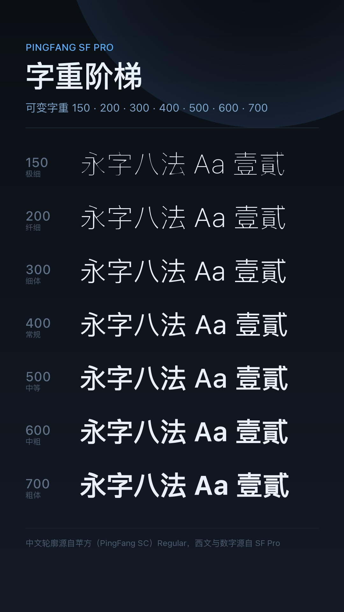

# 苹方 SF Pro · PingFang SF Pro

> **⚠️ 这是一个 Demo 项目。** 整条流水线是通的、产物能装能用，但只在 Python / fontTools 层面做过量化校验，
> **还没有在真机长测**；中文字重除 400 以外全部是几何合成。详见[已知限制](#六已知限制)。
>
> MIUI / HyperOS 字体主题：**中文取苹方（PingFang SC）**，**西文、数字与半角标点取 SF Pro**，
> 打包成**单文件变量字体**，`wght` 轴 150–700 连续可调。



---

## 当前版本

| 组件 | 版本 | 产物 |
|---|---|---|
| 项目 / Release | **1.0-demo**（tag `v1.0.0-demo`） | — |
| MTZ 主题（免 Root） | 1.0-demo | `PingFang-SFPro_v1.0.mtz`（21.2 MiB） |
| 字体文件（包内） | 1.000 | `fonts/Roboto-Regular.ttf`（39,053,128 B） |

改动记录见 [CHANGELOG.md](CHANGELOG.md)。下载见
[Releases](https://github.com/Cheney34/PingFang-SFPro-MTZ/releases)。

### 成品规格

| 项目 | 数值 |
|---|---|
| 字形数 / 码位 | 31,754 glyph / 30,666 cmap |
| 字重轴 | `wght` 150 – 700，默认 400，12 个命名实例 |
| 命名实例 | 150 Ultralight、200 Thin、300 Light、400 Regular、500 Medium、600 Semibold、700 Bold + 5 个中间档 |
| 垂直度量 | hhea 1060 / -340 / 0；OS/2 typo 880 / -220 / 0；win 1060 / 340 |
| 表 | fvar gvar HVAR STAT GDEF GSUB GPOS cmap glyf hmtx …（无 DSIG） |
| MTZ 内文件 | `description.xml` + `fonts/Roboto-Regular.ttf` + `preview/preview_fonts_0..3.jpg` + `preview/preview_fonts_small_0.png` |

---

## 该装哪个

本 Demo 只出了一条通道 —— **MTZ**（走主题引擎，免 Root，可一键切回）。

| 你的情况 | 装什么 | 说明 |
|---|---|---|
| 没 Root，只想换字体 | **MTZ** | 主题商店 / 主题壁纸导入即可 |
| 有 Root（Magisk / KernelSU / APatch） | 暂无 | 本 Demo 没做 Root 模块，见[已知限制](#六已知限制) |
| 想同时换 emoji | 不含 | 本包**只换字体，不动 emoji**；emoji 见作者另一个项目 [chiron-apple-emoji](https://github.com/Cheney34/chiron-apple-emoji) |

装完怎么验：设置 → 显示 → 字体，能看到「苹方 SF Pro」并能在 150–700 之间拖动字重、中文变成苹方字形即为成功。

---

## 目录

| 目录 | 做什么 |
|---|---|
| [`scripts/`](scripts/) | 全流程构建脚本（下载 → 预处理 → 合成 → 变量字体 → 预览 → 打包） |
| [`docs/`](docs/) | 预览图、发版说明、构建与发版流程、酷安文案 |
| `src-pingfang/` `src-sfpro/` | ⚠️ 运行时下载的源字体，**不入库** |
| `work/` `dist/` | 中间产物与成品，**不入库**（成品走 Release） |

---

## 快速开始

```bash
pip install -r requirements.txt

python scripts/01_fetch_sources.py      # 下载两套源字体（约 110 MB）
python scripts/02_prepare_sources.py    # 每字重静态源 + 裁剪（~1 min）
python scripts/03_validate_synth.py     # 可选：合成算法自检
python scripts/04_build_masters.py      # 合成 7 个 CJK 母版（~9 min）
python scripts/05_build_vf.py           # 合并 + varLib 构建（~2 min）
python scripts/06_previews.py           # 渲染预览图
python scripts/07_package_mtz.py        # 打包 dist/PingFang-SFPro_v1.0.mtz
```

环境：Python 3.10+，Windows / macOS / Linux；04 与 05 吃 CPU 与内存（峰值约 2 GB），
跑完 7 个母版合计约 10–15 分钟。

完整的构建、自查清单与发版流程见 [docs/构建与发版.md](docs/构建与发版.md)。

---

## 原理速览

### 1. 为什么是「一个变量字体」

MIUI / HyperOS 字体主题只认 `fonts/Roboto-Regular.ttf` 一个文件，系统按
`description.xml` 里的 `<fontWeight>` 列表去取字重。所以本项目的做法是
**把 7 个「逐点完全兼容」的母版合并成一个变量字体**，而不是塞多个静态 TTF。

### 2. 中西文分工

| 字符范围 | 来源 |
|---|---|
| CJK、假名、全角标点、注音（约 29,180 码位） | PingFang SC |
| 拉丁 / 希腊 / 西里尔 / 数字 / 半角标点 / 符号箭头（1,485 码位） | SF Pro（opsz 固定 17、upem 2048→1000） |

### 3. 中文字重怎么来的（本项目的核心）

苹方官方 6 个静态字重之间**轮廓点并不兼容**（形状签名匹配率 28%–48%，直接丢进
`fontTools.varLib` 会失败）。所以：

1. 只保留**苹方 Regular 的轮廓拓扑**，7 个母版逐点一一对应；
2. 每个字重的目标「墨量」用真实苹方字重测得（相对 Regular：Ultralight 0.345、Thin 0.514、
   Light 0.777、Medium 1.279、Semibold 1.388）；
3. 逐字形求解**法线方向外扩 / 内缩距离**（miter 法线 + 每点碰撞钳制，防止细笔画自交），
   初值由面积-距离关系给出，再用 Newton 迭代收敛（≤5 轮）；
4. 轮廓绕向相反的字（如「四」）靠「沿法线跳 3 个单位后是否落在墨内」的经验探测自动纠向；
5. 700 档由 500 / 600 的真实比例线性外推，避免 varLib 自行外推导致字面塌陷。

**质量对照（25 个随机 CJK 的轮廓 IoU，合成母版 vs 苹果真身）**

| 字重 | 合成 vs 真身 | 基线（直接把 Regular 当该字重用） |
|---|---|---|
| 200 Thin | 0.534 | 0.514 |
| 300 Light | 0.828 | 0.775 |
| 500 Medium | 0.863 | 0.780 |
| 600 Semibold | 0.825 | 0.717 |

渲染墨量随字重严格单调（150→700：2.13% / 2.90% / 3.91% / 4.74% / 5.78% / 6.51% / 7.16%），
效果见 [docs/weight-qa.png](docs/weight-qa.png)。

---

## 六、已知限制

| 限制 | 说明 |
|---|---|
| **只有 400 档是苹果原版轮廓** | 其余 6 个字重是几何合成，笔画端点收笔、复杂字内部空间与 Apple 真身有差异 |
| 细字重偏粗 | 碰撞钳制会让极细笔画提前停止收缩，100 / 200 档比 Apple 真身略粗（100 档面积误差约 8%） |
| 未做真机长测 | 本 Demo 的校验全部在 fontTools / FreeType 层面完成，实际装机效果、各 App 回退链路未测 |
| 无 Root 通道 | 只出 MTZ，没有 Magisk / KernelSU 模块 |
| 不动 emoji | 本包不含 Apple emoji；需要的话用 chiron-apple-emoji 那套 |
| MTZ 签名 | 不同机型 / 系统版本的签名校验策略不同，提示「主题不兼容」时需自己重签 |
| 酷安 / 微博不跟随 | 这类 App 自带字体或渲染器，任何系统级字体替换都无效 |

---

## 文档

- [构建与发版](docs/构建与发版.md) — 从源码到 MTZ，以及发版前自查清单
- [变更记录](CHANGELOG.md) — 每个版本改了什么、哪些已知问题还没做
- [发版说明](docs/release-notes.md) — 当前 Release 正文
- [酷安文案](docs/酷安文案.md) — 发布到酷安用的正文草稿
- [第三方资源与授权](THIRD-PARTY.md) — 苹方 / SF Pro 的授权状况
- [源码索引](SOURCE_INDEX.md) — 每个脚本对应哪一步、产出什么

---

## 许可

- 本仓库的**代码**（构建脚本）：MIT，见 [LICENSE](LICENSE)
- 涉及的字体（PingFang SC、SF Pro）**均为 Apple 专有字体，不可再分发**，见 [THIRD-PARTY.md](THIRD-PARTY.md)
- 本仓库不包含任何字体二进制：`src-*`、`work/`、`dist/` 全部 `.gitignore`

## 致谢

- [PingFang SC 镜像](https://github.com/refinec/PingFangSC) — 中文骨架
- [SF Pro](https://hk.maisfontes.com/sf-pro.font) — 西文 / 数字
- [Chiron-Merriweather](https://github.com/Cheney34/chiron-apple-emoji) — MTZ 结构与字重轴设计参考
- 小米主题开发手册 — `description.xml` 字段与资源目录规范
- [fontTools / varLib](https://github.com/fonttools/fonttools)、numpy、Pillow
